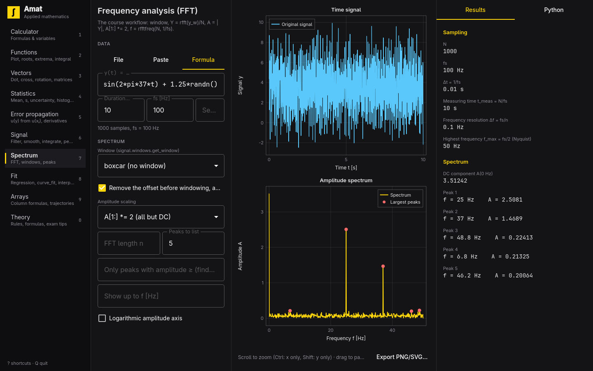

# Amat



Calculations and plots for an applied-mathematics module built on NumPy,
Matplotlib, and SciPy. Each page does one kind of exercise, matches the
library's defaults (results agree with SciPy to about 1e-14), and shows the
same computation as Python you can paste into a notebook.

| Key | Page | What it does |
| --- | --- | --- |
| 1 | Calculator | Formulas with variables, NumPy syntax (`np.degrees(np.arctan2(3.5, 2.1))`) |
| 2 | Functions | Up to four f(x): roots, minima/maxima, symbolic f'(x), integral |
| 3 | Vectors | Magnitude, arctan2 angle, dot/cross product, rotation (active/passive), translation, matrices, rotation-matrix check |
| 4 | Statistics | Mean, s (ddof=1), s/√N, confidence interval, uncertainty budget, `x̄ ± U (k = 2)` rounded to two significant digits; histogram, boxplot; also from N, x̄, s alone |
| 5 | Error propagation | u(y) = √Σ(∂y/∂xᵢ·uᵢ)² with symbolic derivatives (`-8*np.pi**2*L/T**3`), tolerances as a/√3 |
| 6 | Signal | Steps like notebook cells: Butterworth (`sosfiltfilt`), Savitzky–Golay, median, detrend, decimate, time window, d/dt, ∫dt; RMS; `find_peaks` |
| 7 | Spectrum | The FFT workflow: window, `rfft/N`, `A[1:] *= 2`, `rfftfreq`, Δf, Nyquist, peaks above a height |
| 8 | Fit | `linregress`, `polyfit`, `curve_fit` with your own model, `CubicSpline`, `np.interp`, values and slopes at given x |
| 9 | Arrays | New columns row by row (`x = (0.6 + delta_r)*cos(phi)`), plot any column against another |
| 0 | Theory | Rules, formulas, and traps for the theory questions, in German or English |

Data comes from text files (read like `np.loadtxt`, with the delimiter,
header rows, and sample rate detected), WAV files, pasted numbers, or a
formula in t (`3.5 + 2.5*sin(2*pi*25*t) + 1.25*randn()`). Drop a file on the
window or press Ctrl+O. Plots zoom with the wheel and export as PNG or SVG
with a white background. Every input is kept between runs.

The app follows the Omarchy theme and language (English and German).

## Keyboard

| Key | Action |
| --- | --- |
| 1 – 9, 0 | Switch page (Ctrl+1 … also works while typing) |
| Space | Copy the main result |
| Ctrl+O | Open a data file |
| Ctrl+E | Export the plot (PNG or SVG) |
| Ctrl+P | Toggle results / Python |
| Ctrl+Shift+C | Copy the Python code |
| Ctrl+R | Reset the plot zoom |
| Ctrl+Z / Ctrl+Shift+Z | Undo / redo signal processing steps |
| Esc | Leave a text field |
| ? | Show the shortcuts |
| Q | Quit (inputs are kept) |

## Command line

```sh
amat calc "4*pi**2*1.546/2.465**2"
amat stats Strommessung.csv --u 0.001 --unit A     # 0.857 +/- 0.014 A (k = 2)
amat fft messung.csv --window tukey --peaks 3
amat plot "sin(x)/x" --from -10 --to 10 --out plot.svg
amat skill install                                  # agent skill for these commands
```

Each command takes `--json` and exits 1 with the error on stderr.

## Build

```sh
bin/build      # build/amat
bin/test       # Qt Test suite, offscreen
bin/install    # makepkg -fsi: binary, launcher entry, and icon
```

Needs `qmake6`, `make`, a C++17 compiler, and Qt 6 (base, declarative,
svg, wayland). File dialogs go through xdg-desktop-portal.
